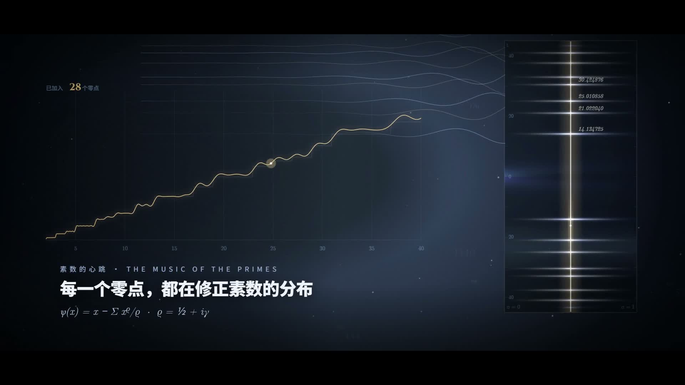
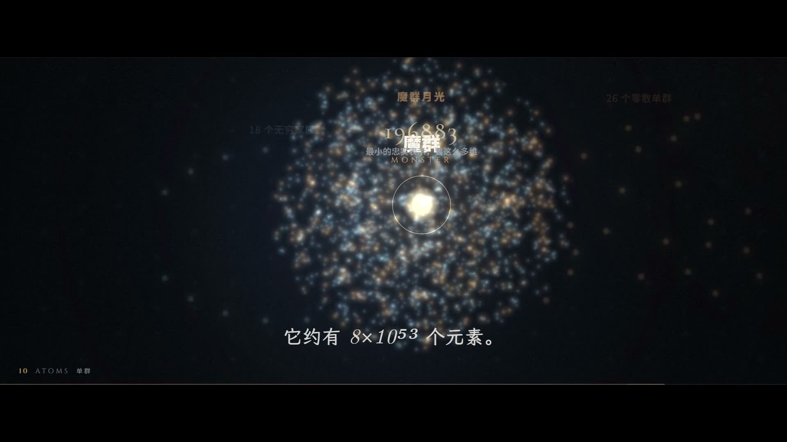
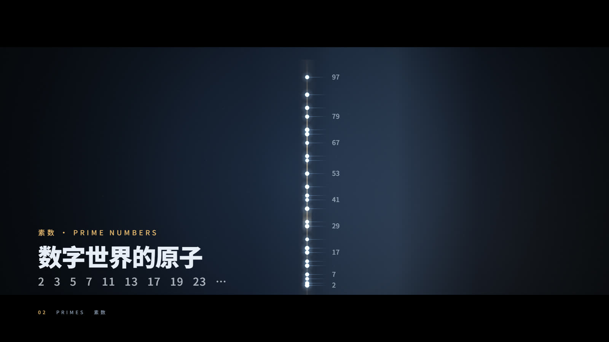

# cinematic-science-film

**Cinematic science explainers, made of code.**

An Agent Skill for turning a theorem, a proof or a physical law into a 84–180 second **single
continuous world** — with a score written in ABC, cut to the same bar grid as the picture, and a mix
that is diagnosed with probes instead of guessed by ear.

[](LICENSE)
[](https://agentskills.io)
[](#install)

[中文](README.md) · [English](README.en.md)




## What this is

Not a renderer — field notes from **two delivered films**: which choices made the frames feel
expensive, which ones made the viewer say "it's a bit noisy", and how each one is checked with numbers
before delivery.

It builds on [`huashu-motion`](https://github.com/alchaincyf/huashu-motion), whose `om` CLI owns the
renderer, the score engine and the studio. This repo only adds the part about **science subjects,
cinematic look, and mix rework**. Install huashu-motion first.

## Why it is different

Most "AI video" flows stop when the picture is generated. The time here goes into the three things
after that:

| Problem | Usual fix | What this does |
|---|---|---|
| It looks like slides | A new visual language per section | **One world, one recurring object**: in the Riemann film a single vertical line is the question, the number axis, the critical line and the dash in the end card |
| Music does not land with the picture | Cut first, paste a track later | The score's `!mark:scene!`s and the picture's `scene:*` labels sit on **the same bar line**; `om sound` reports 0.0–0.3 % tempo bend |
| "It's noisy / there is a thump" | Pull a fader down | **Fold** the low/high envelopes at the bar period and look at phase 0: only a spike at phase 0 is a thump; a peak mid-bar with a quieter phase 0 is a breath |

## Install

```sh
npx skills add dboycht/cinematic-science-film
```

`skills` detects your agent (Claude Code, Codex, DSH, …) and puts the skill in the right folder. Or
just tell your agent:

```
Install the cinematic-science-film skill (github.com/dboycht/cinematic-science-film),
plus its dependency huashu-motion, then run the demo.
```

Manual install: clone this repo anywhere and link the repository root (the folder containing
`SKILL.md`) into `~/.claude/skills/cinematic-science-film` (`~/.codex/skills/` for Codex,
`~/.dsh/skills/` for DSH).

### Requirements

- [`huashu-motion`](https://github.com/alchaincyf/huashu-motion) — required; it ships the `om` CLI.
- Node.js ≥ 22, Chrome, ffmpeg / ffprobe.
- Windows: `om` is a POSIX shim, so call `node <...>/cli/om.js`. The probes here locate
  `huashu-motion/cli` themselves; `OM_CLI` overrides it. Development and acceptance happened on
  Windows; macOS is untested.

## Run the demo

`demo/riemann-lite/` is the smallest film that exercises the whole checklist: the Riemann Hypothesis,
10 bars at 100 BPM, 24 s of score plus a 1.2 s hold, 1920×1080, 30 fps, 2.39:1.



```powershell
$OM   = "$HOME\.claude\skills\huashu-motion\cli\om.js"
$DEMO = "<path to this repo>\demo\riemann-lite"

node $OM check $DEMO                                  # 0 errors / 0 warnings
node $OM still $DEMO --at 0.6,9.5,17.5,21.5           # look at these four frames
node $OM sound $DEMO                                  # writes assets/sound.wav, prints the energy curve
node scripts/probe-score.mjs $DEMO                    # all five voices end on bar 10
node scripts/probe-pulse.mjs "$DEMO\assets\sound.wav" 1 4.5 2.4
node $OM render $DEMO --blur                          # → out/riemann-lite-v1.mp4
```

Expected output (measured):

```
0 errors, 0 warnings
LOW   end beat    40 = 10.00 bars      ← all five voices print this line
marks open@0 primes@8 zeros@20 end@32
energy  open -24.4 · primes -21.1 · zeros -14.1 · end -16.6 dB RMS
P=2.40s low  peak at phase 1%  z(phase0) = 1.9
```

`z = 1.9` is a **once-per-bar** chord onset (the whole-note pad re-attacks on the bar line), below the
skill's warning line `|z| > 2.5`. The thump worth hunting is a **0.6 s beat** period, not a 2.4 s
harmonic change.

## Layout

```
cinematic-science-film/
├── SKILL.md                 # agent entry: shape, Windows reality, five traps, mix, master, checklist
├── references/
│   ├── abc-and-score.md     # the ABC trap (D4 = length 4, not octave 4), voice roster, dynamics
│   └── mix-and-master.md    # how to read the probes, the six layers of "thump", limiter + LUFS
├── examples/
│   ├── riemann-film.md      # 84 s: structure, five rejections, reusable numbers
│   └── group-theory-film.md # 180 s: twelve scenes, no drop, archive negatives, sample pack
├── scripts/
│   ├── probe-score.mjs      # end beat of every voice; a mismatch means the notation is wrong
│   ├── probe-loud.mjs       # 0.1 s RMS + high-frequency energy
│   ├── probe-band.mjs       # <160 Hz vs the residual — kick or cymbal
│   ├── probe-pulse.mjs      # fold at the bar period; read the peak position and sign, not just |z|
│   ├── set-score.mjs        # write an external .abc back into index.html (explicit UTF-8)
│   ├── mux-audio.ps1        # audio-only re-mux: -c:v copy + limiter + ebur128 re-measure
│   └── lib/                 # WAV reader, huashu-motion CLI locator
├── demo/riemann-lite/       # the runnable minimal film (source, score, fonts, treatment)
└── docs/                    # two stills from the delivered films
```

## The method: five hard rules

1. **One world, one recurring object.** Every scene is the same thing seen from a new distance, which
   is why three minutes can hold zero hard cuts.
2. **The score is the timeline.** Fix bar count, BPM, scene labels and `!mark!`s first; the picture
   follows the grid. Confirm every voice is the same length with `probe-score.mjs` before mixing.
3. **Locate, then delete.** "Noisy" is never a fader problem. A 0.6 s-periodic bump below 160 Hz is a
   kick or a piano bass octave; an HF spike every 0.6 s is a snare/cymbal; fold at the bar and only a
   spike **at** phase 0 is a thump.
4. **Make still things actually move.** Three large soft lamps (r 700–900, α .03–.06) drifting at
   40–60 px/s, a breathing background (±8 %), a hand-held camera (±10 px), a scanner band every few
   seconds, a travelling highlight. These five lifted `om qa` from 0.1 to 0.2–0.5 without touching
   the pacing.
5. **Prove that the picture did not move.** For an audio-only change,
   `ffmpeg -map 0:v -c copy -f md5 -` must print the same digest for old and new. With that proof a
   remix costs 10 s instead of 5 400 re-rendered frames.

## Two delivered cases

| | *The Riemann Hypothesis* | *The Beauty of Groups* |
|---|---|---|
| Length / spec | 84 s · 1920×1080 · 30 fps · 2.39:1 | 180 s · 1920×1080 · 30 fps · 2.40:1 |
| Music | 100 BPM · 35 bars · D minor | 80 BPM · 60 bars · 8 voices on real samples |
| Structure | 10 scenes, from "one line" to "1859 — ?" | 12 scenes: one square, 8 moves, 64 cells, 12 pitch classes, the Monster |
| Master | −14.1 LUFS · −3.1 dBTP · LRA 8.9 | −14.0 LUFS · −2.0 dBFS · LRA 6.1 |
| Rejected then | five rounds of "noisy": drums, piano bass octaves, `impact`, `thud/subdrop`, reversed cymbal | 24 of 26 "still" stretches were false positives; the 2 real ones got events |

Full breakdowns in [`examples/`](examples/).

## What it does not do

- **It does not replace huashu-motion.** Nothing runs without it; this repo has no renderer.
- **It does not guarantee taste.** The rules remove the common reasons a film does not feel
  cinematic; they cannot make a dull subject interesting.
- **It does not clear rights for you.** The cases use public-domain images and OFL fonts only, with
  each source recorded in the project's `SOURCES.md` / `LICENSES.md`.
- **It cannot listen for you.** The probes locate the layer; a human still decides whether it sounds
  good, and should listen once, all the way through, before delivery.

## Licence and credits

- This repo: **Apache-2.0**, see [`LICENSE`](LICENSE).
- [`huashu-motion`](https://github.com/alchaincyf/huashu-motion): MIT, © 2026 Huashu.
  `scripts/lib/wav.mjs` adapts its WAV reader (`cli/lib/sound.js`).
- The demo bundles Noto Sans SC (SIL OFL 1.1, see `demo/riemann-lite/assets/fonts/OFL.txt`) and GSAP
  (see `demo/riemann-lite/vendor/GSAP-LICENSE.txt`).
- The stills in `docs/` are frames from the author's own films, not stock images.
